# Simple Audiobooks

Simple Audiobooks ist ein freier Hörbuchplayer für Android, Windows, Linux und macOS. Er spielt Hörbücher
aus Ordnern auf dem Gerät ab, merkt sich für jedes Buch die Stelle, erkennt Kapitel in M4B-, MP3-, Ogg-,
Opus- und FLAC-Dateien und kommt ohne Konto und Werbung aus. Die App gibt es auf Deutsch und Englisch.

[English version](README.md)

<p>
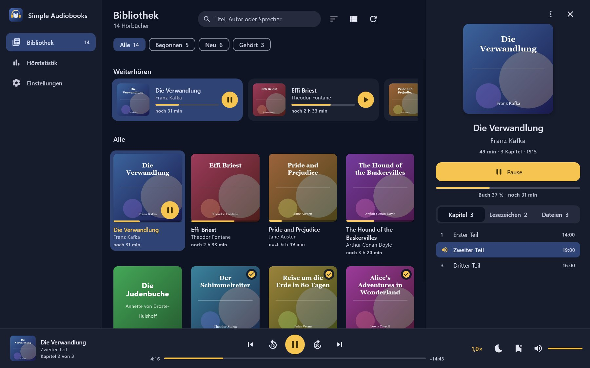
</p>
<p>
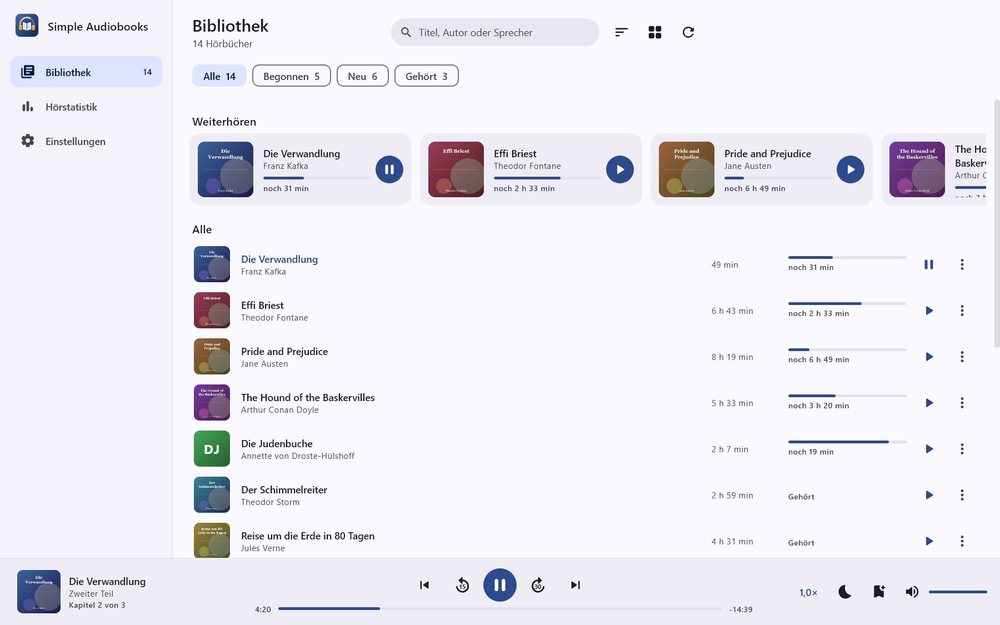
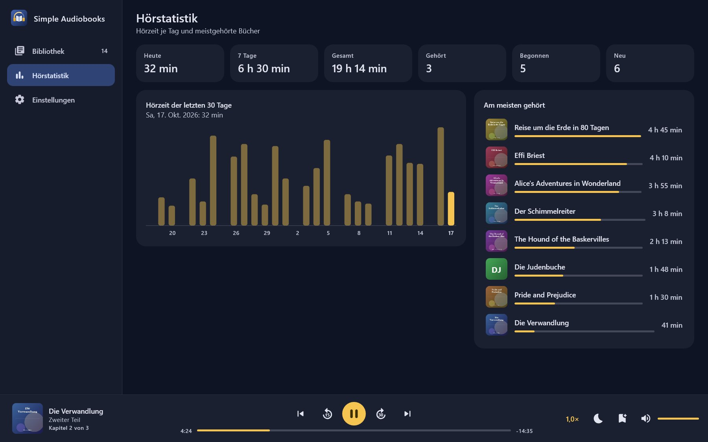
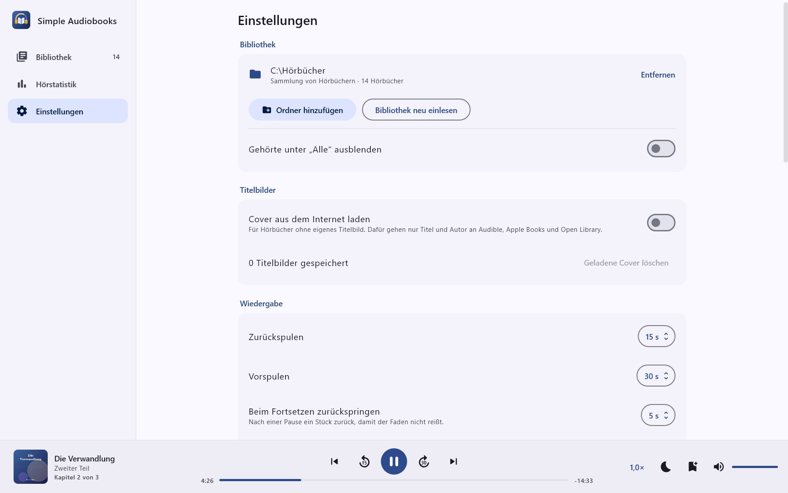
</p>

<p>
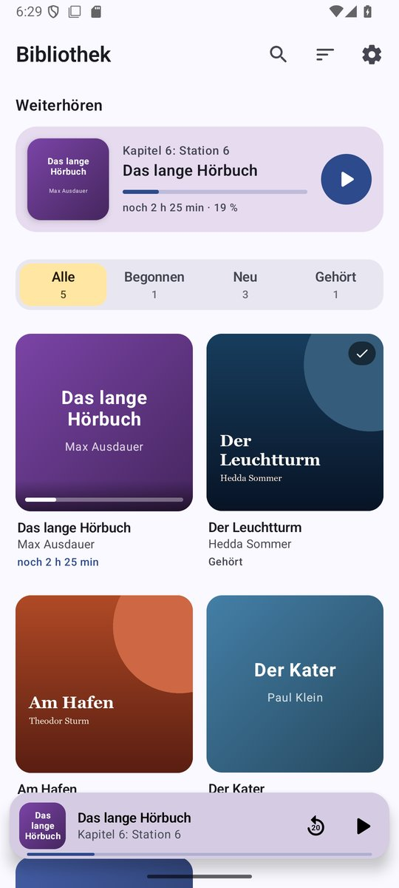
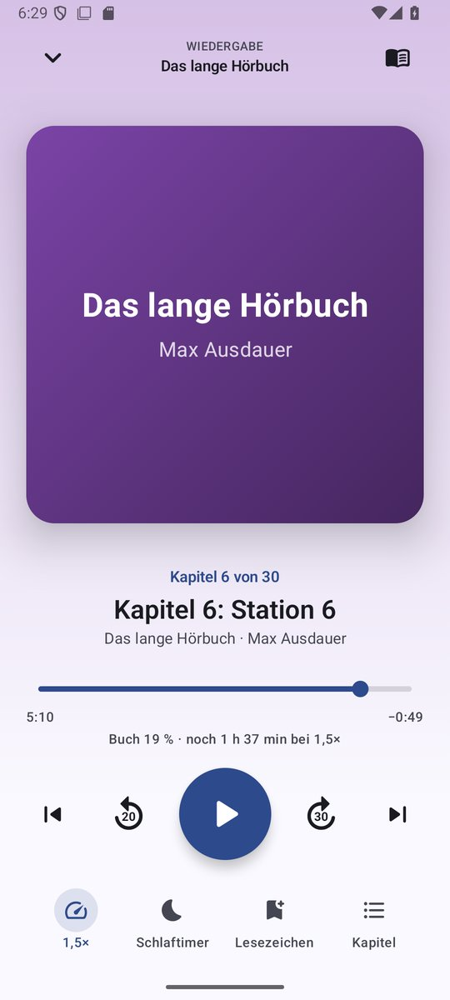
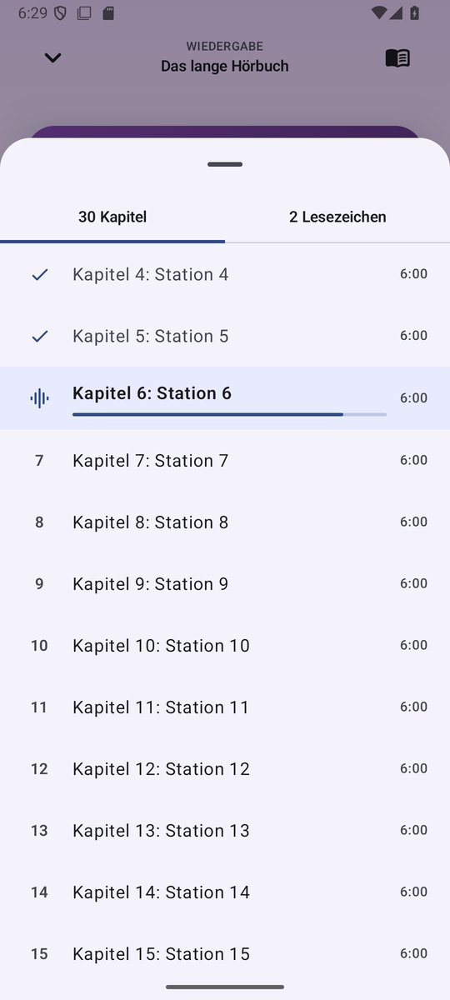
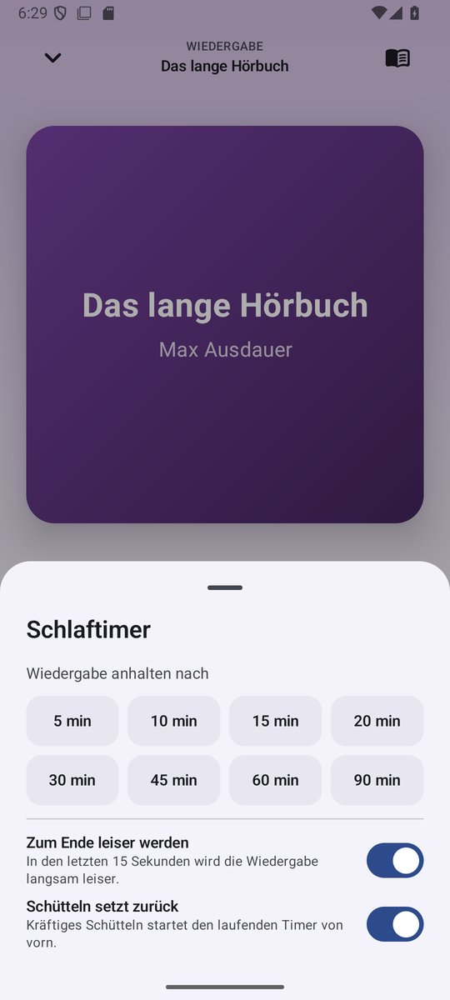
</p>
<p>
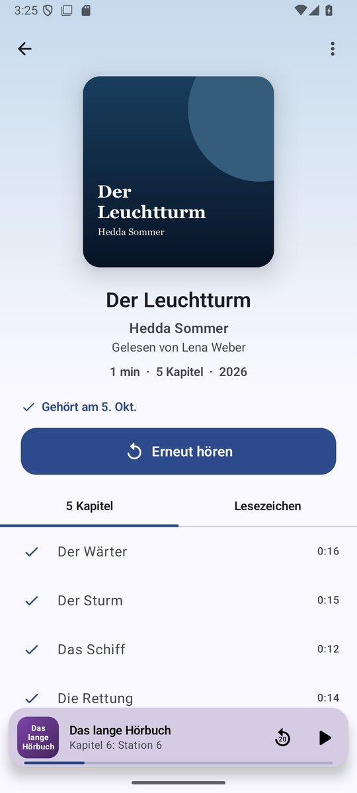
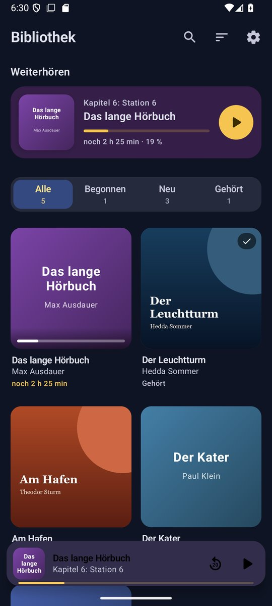
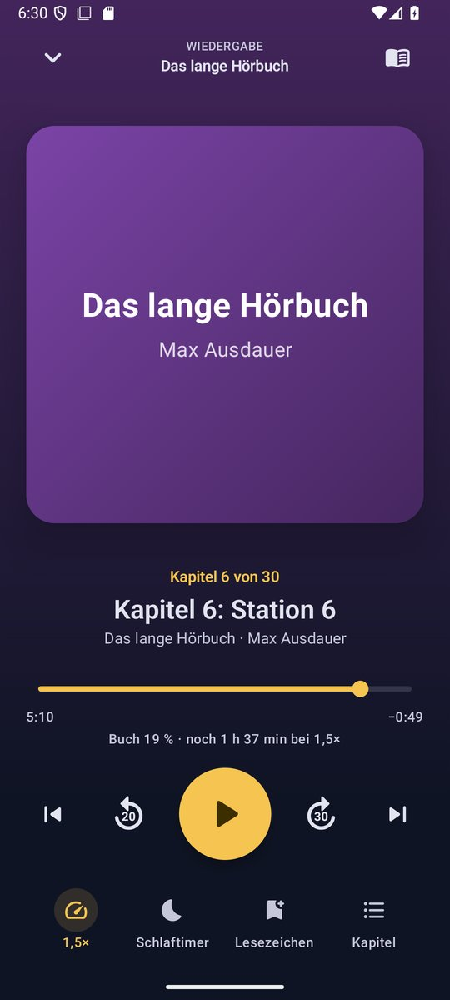
</p>

## Funktionen

**Bibliothek**
- Beliebig viele Bibliotheksordner, auch auf SD-Karten. Ein Ordner ist entweder eine Sammlung von
  Hörbüchern oder ein einzelnes Hörbuch.
- Erkennt Buchordner, CD-Unterordner („CD 1“, „Disc 2“), Autoren- und Reihenordner sowie Sammlungen
  einzelner M4B-Dateien (Regeln unten).
- Titel, Autor, Sprecher und Jahr aus den Tags; fehlen sie, aus Ordnernamen wie „Autor - Titel“.
  Alle Angaben lassen sich in der App ändern.
- Titelbilder aus dem Ordner (`cover.jpg`, `folder.jpg` …), eingebettet in die Datei oder selbst gewählt.
- Titelbilder aus dem Internet für Bücher ohne eigenes, automatisch geladen und auf dem Gerät gespeichert
  (siehe [Datenschutz](#datenschutz)). Über das Buchmenü lässt sich auch von Hand in allen Katalogen suchen.
- Bücher ganz ohne Bild bekommen einen farbigen Platzhalter mit Titel und Autor.
- Startseite mit „Weiterhören“, Filter (Alle, Begonnen, Neu, Gehört), Suche über Titel, Autor und
  Sprecher, sechs Sortierungen, Raster- oder Listenansicht.
- Hörbücher lassen sich aus der Bibliothek entfernen (wiederherstellbar) oder mitsamt ihren Dateien vom
  Gerät löschen.
- Neue, geänderte und entfernte Dateien werden beim Start und per Ziehen nach unten erkannt. Unveränderte
  Bücher werden dabei nicht erneut untersucht.

**Kapitel**
- M4B/M4A: QuickTime-Kapitelspur (iTunes, ffmpeg und die meisten Hörbuchwerkzeuge) und Nero-Kapitelliste.
- MP3: ID3v2.3- und ID3v2.4-CHAP-Rahmen.
- Ogg Vorbis, Opus und FLAC: Vorbis-Kommentare `CHAPTER001=…`, `CHAPTER001NAME=…`.
- Cue-Dateien neben der Audiodatei.
- Ohne eingebettete Kapitel ist jede Datei ein Kapitel; der Titel kommt aus dem Tag oder dem Dateinamen
  („01 - Prolog.mp3“ wird zu „Prolog“).

**Wiedergabe**
- Positionsleiste für das laufende Kapitel, darunter Fortschritt und Restzeit des ganzen Buches,
  bei geändertem Tempo in tatsächlicher Hördauer.
- Zurück- und Vorspulen um einstellbare Sekunden, auch über Dateigrenzen hinweg; Sprung zum vorigen und
  nächsten Kapitel.
- Tempo 0,5× bis 3,0× in Schritten von 0,05, für jedes Buch einzeln, ohne Tonhöhenänderung.
- Stille überspringen und Lautstärke anheben (+3, +6, +9 dB), je Buch.
- Zurückspringen beim Fortsetzen nach einer Pause, auf Wunsch abhängig von der Pausenlänge.
- Schlaftimer nach Minuten oder zum Kapitelende, mit Ausblenden in den letzten 15 Sekunden.
  Kräftiges Schütteln startet den Timer von vorn.
- Lesezeichen mit Notiz, aus dem Player mit einem Tippen.
- Benachrichtigung, Sperrbildschirm und Systemsteuerung mit Zurückspulen, Wiedergabe und Vorspulen.
- Kopfhörertasten „Weiter“ und „Zurück“ spulen um die eingestellten Sekunden oder springen auf Wunsch
  zum Kapitel. Ist kein Buch geladen, setzt die Wiedergabetaste das zuletzt gehörte Buch fort.
- Android Auto: „Zuletzt gehört“ und „Alle Hörbücher“; Sprachsuche („Spiele … in Simple Audiobooks“).

**Sonstiges**
- Hörstatistik mit Tageswerten der letzten 14 Tage und den meistgehörten Büchern.
- Export und Import von Hörständen, Lesezeichen, Statistik und Einstellungen als JSON-Datei, etwa für den
  Umzug auf ein neues Handy. Beim Import wählst du, was übernommen wird. Die Stände werden den vorhandenen
  Büchern zugeordnet, auch wenn sich der Speicherort geändert hat; Bücher, deren Ordner noch nicht gewählt
  ist, werden zugeordnet, sobald er eingelesen ist. Deshalb geht der Import schon auf dem
  Willkommensbildschirm. Die Bibliotheksordner gehören nicht zum Export, ihre Zugriffsrechte gelten nur für
  die Installation, die sie erhalten hat.
- Deutsch und Englisch, umschaltbar in der App (ab Android 13 auch unter Einstellungen > Apps > Sprache).
- Neun Farbschemata: ab Werk Nachtblau und Gold, dazu Petrol, Violett, Waldgrün, Himbeere, Graphit und
  Eisblau, Himmelblau, Salbei und Creme sowie Bernstein; ab Android 12 auch die Farben des
  Hintergrundbilds. Helles oder dunkles Design, das dunkle auf Wunsch mit schwarzem Hintergrund.

## Desktop: Windows, Linux und macOS

Die Desktop-Fassung teilt sich Bibliothek, Kapitelerkennung, Titelbilder und Export mit der Android-App
und hat eine eigene Oberfläche für breite Fenster: links eine Leiste mit Bibliothek, Statistik und
Einstellungen, die Bibliothek als Raster oder Liste mit einem Detailbereich für das gewählte Buch
(Kapitel, Lesezeichen, Dateien) und unten eine Wiedergabeleiste mit Kapitelposition, Tempo, Stille
überspringen, Lautstärkeanhebung, Schlaftimer, Lesezeichen und Lautstärke. Ein Rechtsklick auf ein Buch
öffnet sein Menü, ein Doppelklick spielt es. Die Wiedergabe läuft über FFmpeg, deshalb spielt jedes unten
genannte Format auf jedem System.

| Datei | Für |
|---|---|
| `SimpleAudiobooks-1.5.0-windows-x64.msi` | Windows 10 und 11, installiert für den angemeldeten Benutzer ohne Administratorrechte |
| `SimpleAudiobooks-1.5.0-windows-x64.zip` | Windows 10 und 11 ohne Installation: entpacken, `Simple Audiobooks.exe` starten |
| `SimpleAudiobooks-1.5.0-linux-amd64.deb` | Debian, Ubuntu, Linux Mint und andere Distributionen mit dpkg (x86_64) |
| `SimpleAudiobooks-1.5.0-linux-x64.tar.gz` | andere Linux-Distributionen (x86_64): entpacken, `bin/Simple Audiobooks` starten |
| `SimpleAudiobooks-1.5.0-macos-arm64.zip` | macOS 11 und neuer auf Apple-Chips |

Die Pakete bringen ihre eigene Java-Laufzeit und FFmpeg mit, weitere Installationen sind nicht nötig.

| Tasten | Wirkung |
|---|---|
| Leertaste | Wiedergabe und Pause |
| ← → | Zurück- und Vorspulen um die eingestellten Sekunden |
| Umschalt + ← → | voriges und nächstes Kapitel |
| Strg + F (⌘ F unter macOS) | in der Bibliothek suchen |
| Strg + B (⌘ B unter macOS) | Lesezeichen an der aktuellen Stelle |
| Esc | Detailbereich schließen |

Unterschiede zu Android: Android Auto, Sperrbildschirm- und Kopfhörersteuerung sowie das Schütteln für
den Schlaftimer gibt es am Rechner nicht. Wird ein Buch mitsamt seinen Dateien gelöscht, wandern die
Dateien in den Papierkorb, sofern das System einen hat. Exportdateien lassen sich frei zwischen Android
und Desktop austauschen.

| System | Daten (Hörstände, Einstellungen, Titelbilder) | Zwischenspeicher (FFmpeg-Bibliotheken, beim ersten Start ausgepackt) |
|---|---|---|
| Windows | `%APPDATA%\SimpleAudiobooks` | `%LOCALAPPDATA%\SimpleAudiobooks\cache` |
| macOS | `~/Library/Application Support/SimpleAudiobooks` | `~/Library/Caches/SimpleAudiobooks` |
| Linux | `~/.local/share/simple-audiobooks` | `~/.cache/simple-audiobooks` |

**macOS:** Die App ist ad hoc signiert, aber nicht von Apple beglaubigt (notarisiert). Sie wurde ohne Mac
zusammengestellt und ist auf einem Mac noch nicht getestet. Beim ersten Start verweigert macOS das Öffnen.
Freigeben lässt sie sich unter Systemeinstellungen > Datenschutz & Sicherheit > „Dennoch öffnen“ oder im
Terminal durch Entfernen der Quarantäne-Markierung:

```
xattr -dr com.apple.quarantine "/Applications/Simple Audiobooks.app"
```

## Datenschutz

Simple Audiobooks hat kein Konto, keine Werbung, keine Nutzungsstatistik und keine Absturzberichte. Deine
Audiodateien verlassen das Gerät nie.

Ins Internet geht die App nur für Titelbilder, und nur solange „Cover aus dem Internet laden“ an ist
(Einstellungen > Titelbilder, ab Werk an):

| Was | An wen | Wann |
|---|---|---|
| Titel und Autor eines Buches ohne Titelbild | `api.audible.de` oder `api.audible.com`, `itunes.apple.com`, `openlibrary.org` | einmal je Buch; ohne Treffer nach 30 Tagen erneut oder sobald du Titel oder Autor änderst |
| Dein Suchtext | dieselben drei Kataloge | bei „Cover online suchen“ |
| Abruf des gewählten Bildes | `m.media-amazon.com`, `is1-ssl.mzstatic.com` und ähnliche, `covers.openlibrary.org` | nach einem Treffer oder deiner Wahl |

Mit Deutsch als App-Sprache fragt die App Audible.de und den deutschen Apple-Katalog, mit jeder anderen
Sprache die US-Kataloge. Automatisch übernommen wird ein Bild nur, wenn der Titel passt und der Autor
übereinstimmt. Bei Büchern ohne Autor braucht der Titel mindestens drei Wörter, und jeder Treffer mit
diesem Titel muss denselben Autor nennen. Podcastfolgen werden übergangen.

Geladene Titelbilder liegen im privaten Speicher der App. Wer die Einstellung abschaltet, blendet sie aus
und beendet alle Abfragen; „Geladene Cover löschen“ entfernt sie. Ein einzelnes falsches Bild verschwindet
über „Online-Cover entfernen“ im Buchmenü, danach sucht die App für dieses Buch nicht mehr.

Die Titelbilder gehören den jeweiligen Verlagen. Die Kataloge sind öffentliche Suchschnittstellen ohne
Schlüssel: die Katalog-API von Audible, die iTunes Search API und die Such-API von Open Library.

## Wie Ordner erkannt werden

Bei einem Ordner vom Typ „Sammlung von Hörbüchern“ gilt:

| Aufbau | Ergebnis |
|---|---|
| `Hörbücher/Buch/01.mp3, 02.mp3` | ein Buch „Buch“ |
| `Hörbücher/Buch/CD 1/…`, `Hörbücher/Buch/CD 2/…` | ein Buch mit allen CDs in natürlicher Reihenfolge |
| `Hörbücher/Autor/Buch A/…`, `Hörbücher/Autor/Buch B/…` | zwei Bücher, „Autor“ dient als Autor, wenn die Tags keinen nennen |
| `Hörbücher/Reihe/Band 1.m4b`, `Band 2.m4b` | jede M4B-Datei ist ein eigenes Buch |
| `Hörbücher/Kurzgeschichte.opus` | lose Dateien direkt im Bibliotheksordner sind je ein Buch |

Ein Ordner mit eigenen Audiodateien ist immer ein Buch, Unterordner gehören dazu. Dateien werden
natürlich sortiert: „Teil 2“ vor „Teil 10“. Bei „Ein einzelnes Hörbuch“ bilden alle Dateien im
Ordner ein Buch.

Unterstützte Formate: MP3, M4B, M4A, AAC, OGG, Opus, FLAC, WAV, MKA, WebM-Audio.

## Bauen

Voraussetzungen: JDK 17 und das Android SDK mit Plattform 35. Der Projektpfad darf keine Umlaute
enthalten, sonst bricht das Android-Gradle-Plugin ab.

```
./gradlew :app:testDebugUnitTest    # Unit-Tests, darunter Kapitel-Parser gegen echte Dateien
./gradlew :app:lintDebug            # Lint
./gradlew :app:assembleDebug        # app/build/outputs/apk/debug/app-debug.apk
./gradlew :app:assembleRelease      # verkleinertes Release-APK
```

Für ein signiertes Release-APK eine Datei `keystore.properties` im Projektordner anlegen
(wird nicht eingecheckt):

```
storeFile=keystore/simpleaudiobooks-release.jks
storePassword=…
keyAlias=simpleaudiobooks
keyPassword=…
```

Für die Desktop-Pakete braucht es ein JDK 17 mit `jpackage` (etwa Eclipse Temurin):

```
./gradlew :desktop:run                  # aus den Quellen starten
./gradlew :desktop:test                 # Tests ohne Fenster und Ton, Wiedergabe über FFmpeg in eine stumme Ausgabe
./gradlew :desktop:createDistributable  # Programmordner für das laufende System
./gradlew :desktop:packageMsi           # Windows-Installer (nutzt WiX 3, WIX_PATH für eine lokale Kopie)
./gradlew :desktop:packageDeb           # Debian-Paket, unter Linux
./gradlew :desktop:screenshots -Psa.demo=<neuer Ordner>   # die Desktop-Bilder oben, ohne Fenster gerechnet
```

Eingepackt werden die FFmpeg-Bibliotheken des bauenden Systems; `-Psa.platform=linux-x86_64`,
`windows-x86_64` oder `macosx-arm64` wählt andere. Ein fertiges Programm prüft sich selbst ohne Fenster
und ohne Ton: `"Simple Audiobooks" --selbsttest bericht.txt` untersucht und spielt zwei kurze
Testdateien, rechnet die Oberfläche unsichtbar und endet bei Erfolg mit 0.

## Aufbau

Gemeinsamer Code beider Apps liegt in `app/src/main/java`, Android-eigener in `app/src/android/java`,
die Desktop-App in `desktop/src/main/kotlin`.

| Paket | Inhalt |
|---|---|
| `data` | Datenmodell (`Book`, `Track`, `Chapter`, `BookState`), `Library` als einzige Quelle für Bücher und Hörstände, Einstellungen, Statistik, Export und Import |
| `scan` | Gruppierung zu Büchern, Tags, Titelbilder; der Ordnerzugriff je Plattform (Storage Access Framework auf Android, Dateisystem am Desktop) |
| `scan.chapters` | Parser für MP4-, ID3-, Vorbis- und Cue-Kapitel, ohne Android-Abhängigkeit und per Unit-Test geprüft |
| `online` | Kataloge für Titelbilder, Trefferregeln und die Suche im Hintergrund |
| `playback` | Schlaftimer und Rücksprungregeln; auf Android `PlaybackService` (Media3 `MediaLibraryService`) und die Player-Hülle |
| `ui` | Android: Jetpack-Compose-Oberfläche; gemeinsam: die Farbschemata |
| `desktop` | Desktop-App: Untersuchen und Dekodieren mit FFmpeg über JavaCV, Tonausgabe über Java Sound, Oberfläche mit Compose Multiplatform |

Hörstände liegen in `states.json`, die eingelesenen Bücher in `books.json`, beides im privaten
App-Speicher (am Desktop im Datenordner) und atomar geschrieben. Positionen werden während der
Wiedergabe auf Android alle 15 Sekunden und am Desktop alle 5 Sekunden, bei Pause und nach jedem Sprung
gesichert.

## Lizenz

Simple Audiobooks ist freie Software unter der GNU General Public License, Version 3 oder später
(`GPL-3.0-or-later`), siehe [LICENSE](LICENSE).

Bibliotheken auf Android: AndroidX, Jetpack Compose und Media3 (Apache 2.0), Kotlin und
kotlinx (Apache 2.0), Coil (Apache 2.0).

Bibliotheken am Desktop: Compose Multiplatform und Skiko (Apache 2.0), Skia (BSD 3-Clause), Kotlin und
kotlinx (Apache 2.0), JavaCV und JavaCPP (Apache 2.0), FFmpeg 7.1 (LGPL 2.1 oder später) in der
LGPL-Fassung der [JavaCPP Presets](https://github.com/bytedeco/javacpp-presets/tree/1.5.11/ffmpeg)
1.5.11, Quellcode bei [ffmpeg.org](https://ffmpeg.org/releases/ffmpeg-7.1.tar.xz). FFmpeg wird als
eigene Bibliotheken geladen und lässt sich austauschen. Die Pakete enthalten eine OpenJDK-Laufzeit
(GPL 2.0 mit Classpath Exception), deren Lizenzen im Ordner `legal` der Laufzeit liegen.
