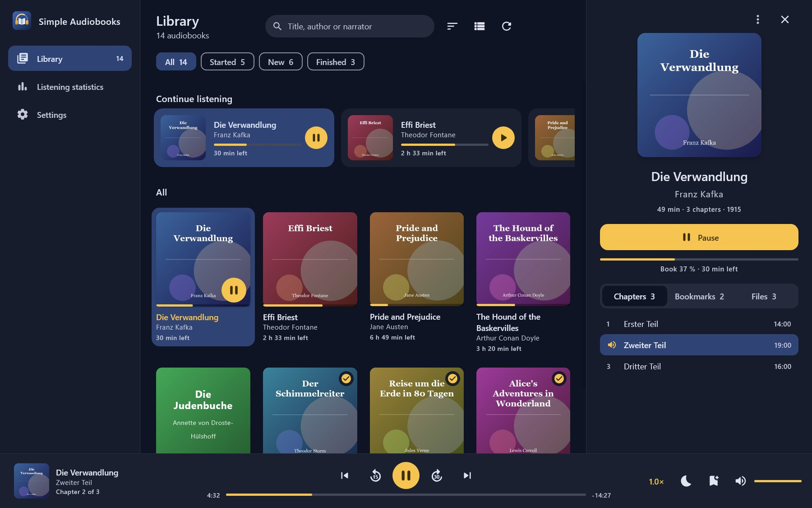
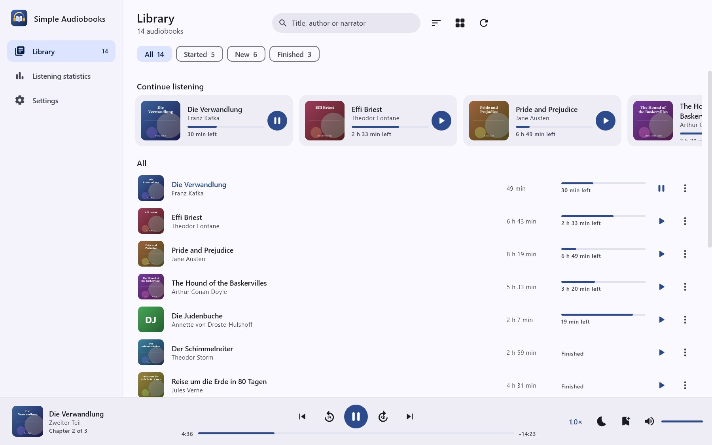
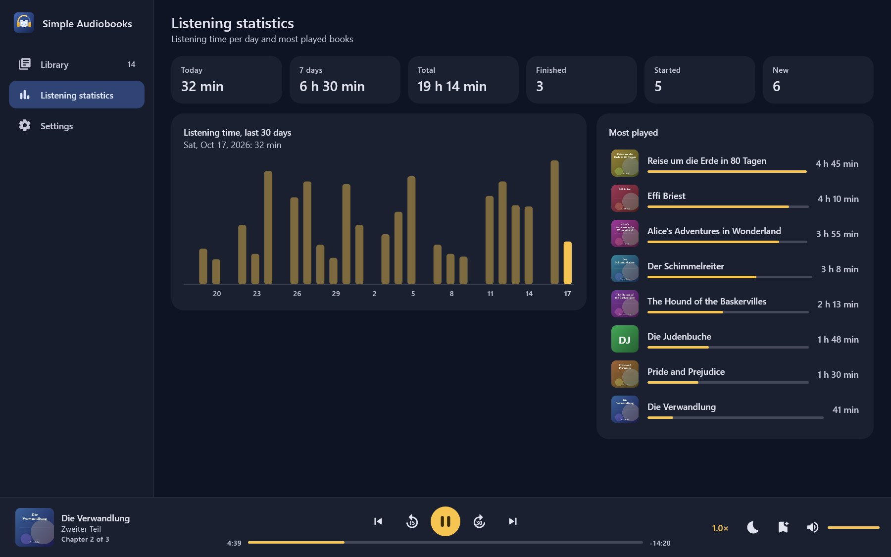
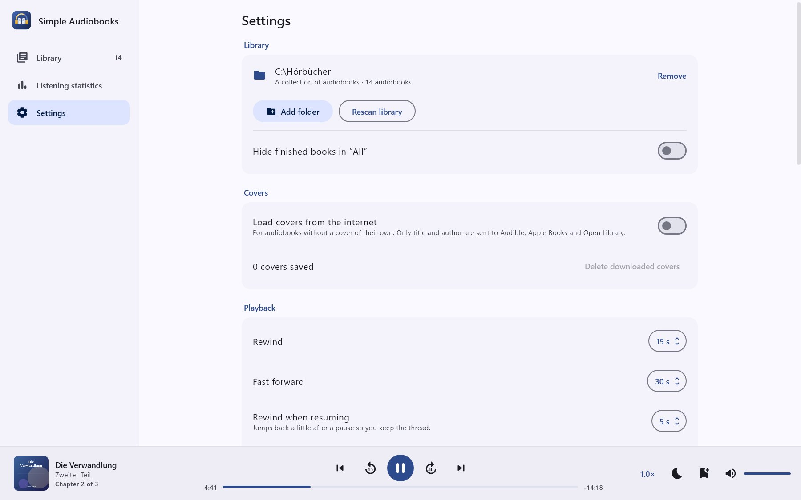

# Simple Audiobooks

Simple Audiobooks is a free audiobook player for Android, Windows, Linux and macOS. It plays audiobooks
from folders on your device, remembers the position in every book, reads chapters from M4B, MP3, Ogg, Opus
and FLAC files and needs no account and no ads. The app is available in English and German.

[Deutsche Fassung](README.de.md)

<p><a href="https://buymeacoffee.com/regard2462"></a></p>

<p>

</p>
<p>



</p>

<p>


</p>
<p>


</p>

## Features

**Library**
- Any number of library folders, SD cards included. A folder is either a collection of audiobooks or a
  single audiobook.
- Detects book folders, disc subfolders ("CD 1", "Disc 2"), author and series folders and collections of
  single M4B files (rules below).
- Title, author, narrator and year from the tags; without tags from folder names such as "Author - Title".
  Everything can be edited in the app.
- Covers from the folder (`cover.jpg`, `folder.jpg` …), embedded in the file or picked by you.
- Covers from the internet for books without one, loaded automatically and stored on the device
  (see [Privacy](#privacy)). The book menu also offers a manual search across all catalogues.
- Books without any cover get a coloured placeholder with title and author.
- Home screen with "Continue listening", filters (All, Started, New, Finished), search across title,
  author and narrator, six sort orders, grid or list.
- Books can be removed from the library (and restored later) or deleted from the device together with
  their files.
- New, changed and removed files are picked up on start and by pulling down. Unchanged books are not
  read again.

**Chapters**
- M4B/M4A: QuickTime chapter track (iTunes, ffmpeg and most audiobook tools) and Nero chapter list.
- MP3: ID3v2.3 and ID3v2.4 CHAP frames.
- Ogg Vorbis, Opus and FLAC: Vorbis comments `CHAPTER001=…`, `CHAPTER001NAME=…`.
- Cue sheets next to the audio file.
- Without embedded chapters every file is a chapter, named after its tag or file name
  ("01 - Prologue.mp3" becomes "Prologue").

**Playback**
- Seek bar for the current chapter, below it progress and time left for the whole book, in real
  listening time when the speed is changed.
- Skip back and forward by a configurable number of seconds, across file boundaries; jump to the previous
  and next chapter.
- Speed from 0.5× to 3.0× in steps of 0.05, per book, without pitch change.
- Skip silence and volume boost (+3, +6, +9 dB), per book.
- Rewind when resuming after a pause, optionally depending on the length of the pause.
- Sleep timer by minutes or to the end of the chapter, fading out over the last 15 seconds. A firm shake
  restarts the timer.
- Bookmarks with notes, one tap from the player.
- Notification, lock screen and system controls with rewind, play and fast forward.
- Headset "next" and "previous" skip by the configured seconds or, if you prefer, by chapter. With no
  book loaded, the play button resumes the last book.
- Android Auto: "Recently played" and "All audiobooks"; voice search ("Play … on Simple Audiobooks").

**More**
- Listening statistics with daily totals for the last 14 days and the most played books.
- Export and import of progress, bookmarks, statistics and settings as a JSON file, for example to move to
  a new phone. On import you choose what to take over. Progress is matched to the books present, even when
  their location changed; books whose folder is not chosen yet are matched as soon as it has been scanned,
  so you can import right on the welcome screen. Library folders are not part of the export, their access
  rights only hold for the installation that received them.
- English and German, switchable in the app (on Android 13 and later also under Settings > Apps > Language).
- Nine colour schemes, night blue and gold by default, plus petrol, violet, forest green, raspberry,
  graphite and ice blue, sky blue, sage and cream, and amber; on Android 12 and later also the colours of
  your wallpaper. Light or dark theme, the dark one optionally with a pure black background.

## Desktop: Windows, Linux and macOS

The desktop version shares the library, chapter, cover and export code with the Android app and has a
layout of its own for wide windows: a sidebar with library, statistics and settings, the library as a grid
or list with a details panel for the selected book (chapters, bookmarks, files), and a player bar at the
bottom with the chapter seek bar, speed, skip silence, volume boost, sleep timer, bookmarks and volume.
A right click on a book opens its menu, a double click plays it. Playback uses FFmpeg, so every format
listed below plays on every system.

| File | For |
|---|---|
| `SimpleAudiobooks-1.5.0-windows-x64.msi` | Windows 10 and 11, installs for the current user without admin rights |
| `SimpleAudiobooks-1.5.0-windows-x64.zip` | Windows 10 and 11 without installation: unpack, start `Simple Audiobooks.exe` |
| `SimpleAudiobooks-1.5.0-linux-amd64.deb` | Debian, Ubuntu, Linux Mint and other distributions with dpkg (x86_64) |
| `SimpleAudiobooks-1.5.0-linux-x64.tar.gz` | other Linux distributions (x86_64): unpack, start `bin/Simple Audiobooks` |
| `SimpleAudiobooks-1.5.0-macos-arm64.zip` | macOS 11 and later on Apple silicon |

The packages bring their own Java runtime and FFmpeg; nothing else needs to be installed.

| Keys | Action |
|---|---|
| Space | play and pause |
| ← → | rewind and fast forward by the configured seconds |
| Shift + ← → | previous and next chapter |
| Ctrl + F (⌘ F on macOS) | search the library |
| Ctrl + B (⌘ B on macOS) | bookmark the current position |
| Esc | close the details panel |

Differences to Android: there is no Android Auto, no lock screen or headset control and no shaking to
restart the sleep timer. Deleting a book together with its files moves them to the trash where the system
has one. Export files can be moved freely between Android and desktop.

| System | Data (progress, settings, covers) | Cache (FFmpeg libraries, unpacked on first start) |
|---|---|---|
| Windows | `%APPDATA%\SimpleAudiobooks` | `%LOCALAPPDATA%\SimpleAudiobooks\cache` |
| macOS | `~/Library/Application Support/SimpleAudiobooks` | `~/Library/Caches/SimpleAudiobooks` |
| Linux | `~/.local/share/simple-audiobooks` | `~/.cache/simple-audiobooks` |

**macOS:** the app is signed ad hoc but not notarized by Apple, and it was put together without a Mac, so
it has not been tested on one yet. macOS refuses to open it the first time. Open it anyway under System
Settings > Privacy & Security > "Open Anyway", or remove the quarantine flag in Terminal:

```
xattr -dr com.apple.quarantine "/Applications/Simple Audiobooks.app"
```

## Privacy

Simple Audiobooks has no account, no ads, no analytics and no crash reporting. Your audio files never leave
the device.

The app only goes online to find covers, and only while "Load covers from the internet" is switched on
(Settings > Covers, on by default):

| What | Sent to | When |
|---|---|---|
| Title and author of a book without a cover | `api.audible.de` or `api.audible.com`, `itunes.apple.com`, `openlibrary.org` | once per book; again after 30 days if nothing matched, or when you change title or author |
| Your search text | the same three catalogues | when you use "Search cover online" |
| Download of the chosen picture | `m.media-amazon.com`, `is1-ssl.mzstatic.com` and similar, `covers.openlibrary.org` | after a match or your choice |

With German as app language the app asks Audible.de and the German Apple catalogue, with any other
language the US ones. A cover is only taken automatically when the title matches and the author agrees.
For books without an author the title needs at least three words and every result with that title has to
name the same author. Podcast episodes are ignored.

Downloaded covers are kept in the app's private storage. Switching the option off hides them and stops all
requests, "Delete downloaded covers" removes them. A single wrong cover goes away with "Remove online
cover" in the book menu; the app then leaves that book alone.

Cover pictures belong to their publishers. The catalogues are public search interfaces that need no key:
the Audible catalogue API, the iTunes Search API and the Open Library search API.

## How folders are read

For a folder of the type "A collection of audiobooks":

| Layout | Result |
|---|---|
| `Audiobooks/Book/01.mp3, 02.mp3` | one book "Book" |
| `Audiobooks/Book/CD 1/…`, `Audiobooks/Book/CD 2/…` | one book with all discs in natural order |
| `Audiobooks/Author/Book A/…`, `Audiobooks/Author/Book B/…` | two books; "Author" becomes the author when the tags name none |
| `Audiobooks/Series/Part 1.m4b`, `Part 2.m4b` | every M4B file is a book of its own |
| `Audiobooks/Short story.opus` | loose files directly in the library folder are one book each |

A folder with audio files of its own is always one book, its subfolders belong to it. Files are sorted
naturally: "Part 2" before "Part 10". With "A single audiobook" all files in the folder form one book.

Supported formats: MP3, M4B, M4A, AAC, OGG, Opus, FLAC, WAV, MKA, WebM audio.

## Building

Requirements: JDK 17 and the Android SDK with platform 35. Keep the project path ASCII only, the Android
Gradle plugin fails on other characters in it.

```
./gradlew :app:testDebugUnitTest    # unit tests, chapter parsers run against real files
./gradlew :app:lintDebug            # lint
./gradlew :app:assembleDebug        # app/build/outputs/apk/debug/app-debug.apk
./gradlew :app:assembleRelease      # minified release APK
```

For a signed release APK create `keystore.properties` in the project folder (it is not checked in):

```
storeFile=keystore/simpleaudiobooks-release.jks
storePassword=…
keyAlias=simpleaudiobooks
keyPassword=…
```

The desktop app needs a JDK 17 that contains `jpackage` (for example Eclipse Temurin) for packaging:

```
./gradlew :desktop:run                  # start from the sources
./gradlew :desktop:test                 # tests without window and sound, playback through FFmpeg into a silent output
./gradlew :desktop:createDistributable  # program folder for the current system
./gradlew :desktop:packageMsi           # Windows installer (uses WiX 3, set WIX_PATH for a local copy)
./gradlew :desktop:packageDeb           # Debian package, on Linux
./gradlew :desktop:screenshots -Psa.demo=<new folder>   # the desktop screenshots above, rendered off screen
```

The FFmpeg libraries of the building system are packed in; `-Psa.platform=linux-x86_64`,
`windows-x86_64` or `macosx-arm64` chooses another one. A finished program checks itself without a
window and without sound: `"Simple Audiobooks" --selbsttest report.txt` probes and plays two short test
files, renders the interface off screen and exits with 0 on success.

## Structure

Code shared by both apps lives in `app/src/main/java`, Android-only code in `app/src/android/java`, the
desktop app in `desktop/src/main/kotlin`.

| Package | Content |
|---|---|
| `data` | data model (`Book`, `Track`, `Chapter`, `BookState`), `Library` as the single source of books and progress, settings, statistics, export and import |
| `scan` | grouping into books, tags, covers; folder access per platform (Storage Access Framework on Android, the file system on the desktop) |
| `scan.chapters` | parsers for MP4, ID3, Vorbis and cue chapters, free of Android code and covered by unit tests |
| `online` | cover catalogues, matching rules and the background lookup |
| `playback` | sleep timer and rewind rules; on Android `PlaybackService` (Media3 `MediaLibraryService`) and the player wrapper |
| `ui` | Android: Jetpack Compose screens; shared: the colour schemes |
| `desktop` | desktop app: FFmpeg probing and decoding through JavaCV, audio output through Java Sound, Compose Multiplatform interface |

Progress lives in `states.json`, the scanned books in `books.json`, both in the app's private storage
(on the desktop in the data folder) and written atomically. Positions are saved every 15 seconds on
Android and every 5 seconds on the desktop while playing, on pause and after every jump.

## License

Simple Audiobooks is free software under the GNU General Public License, version 3 or later
(`GPL-3.0-or-later`), see [LICENSE](LICENSE).

Libraries on Android: AndroidX, Jetpack Compose and Media3 (Apache 2.0), Kotlin and kotlinx (Apache 2.0),
Coil (Apache 2.0).

Libraries on the desktop: Compose Multiplatform and Skiko (Apache 2.0), Skia (BSD 3-Clause), Kotlin and
kotlinx (Apache 2.0), JavaCV and JavaCPP (Apache 2.0), FFmpeg 7.1 (LGPL 2.1 or later) in the LGPL build
of the [JavaCPP Presets](https://github.com/bytedeco/javacpp-presets/tree/1.5.11/ffmpeg) 1.5.11, source
code at [ffmpeg.org](https://ffmpeg.org/releases/ffmpeg-7.1.tar.xz). FFmpeg is loaded as separate shared
libraries and can be replaced. The packages contain an OpenJDK runtime (GPL 2.0 with Classpath
Exception), its licences are in the `legal` folder of the runtime.
